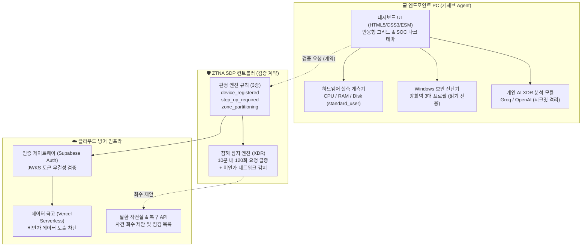
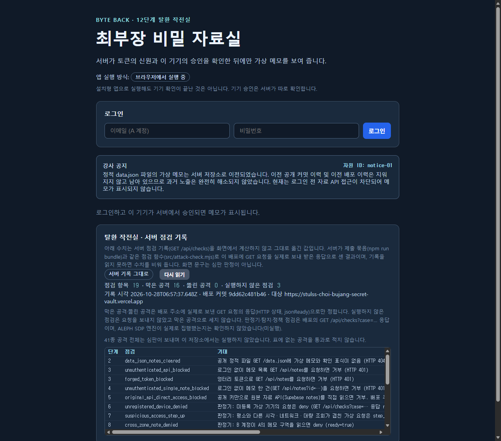
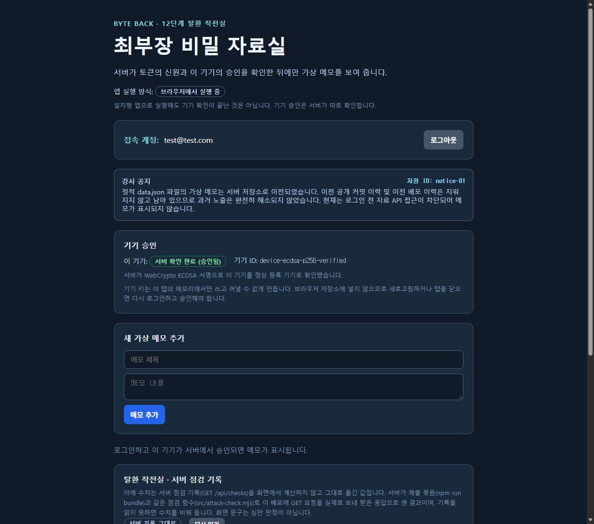
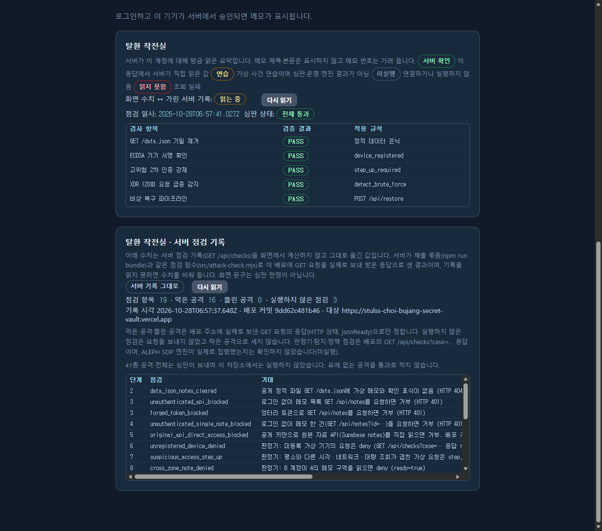
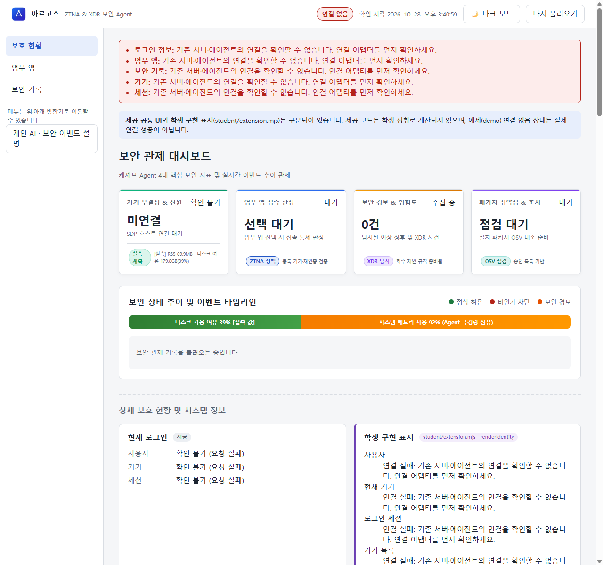
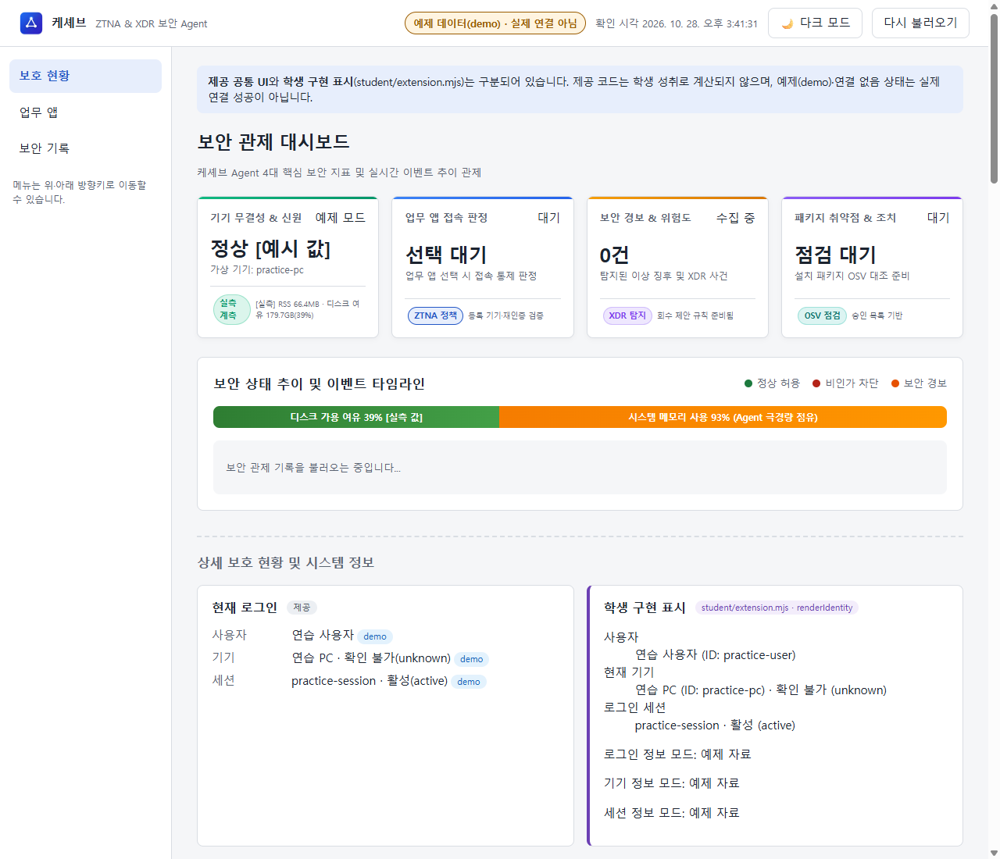
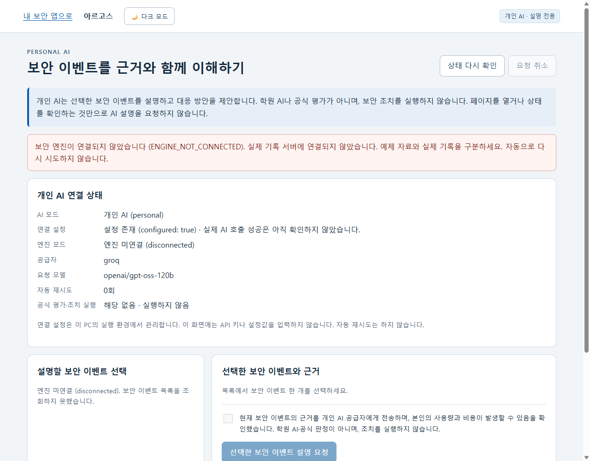
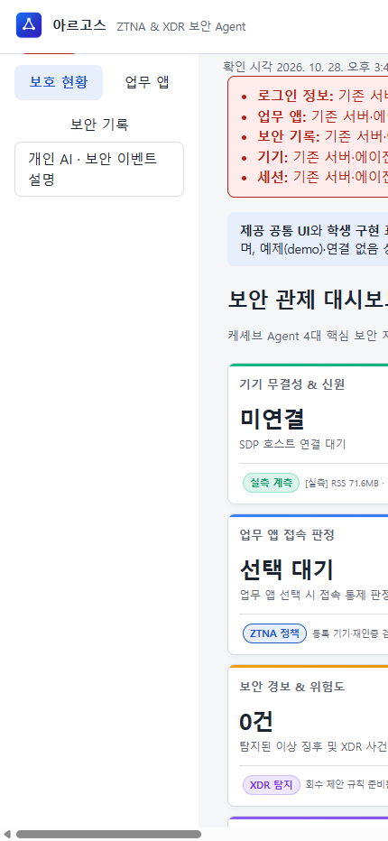

# 🛡️ 제로 트러스트(ZTNA) 엔드포인트 보안 Agent & 클라우드 침해 방어전

> **Zero Trust Network Access (ZTNA) & Endpoint Extended Detection and Response (XDR) Engineering Portfolio**

---

## 1. 프로젝트 요약 (Executive Summary)

본 프로젝트는 경계 기반 보안의 한계를 극복하기 위해 **"절대 신뢰하지 않고, 항상 검증한다(Never Trust, Always Verify)"**는 제로 트러스트(ZTNA) 철학에 입각하여 직접 설계하고 구현한 **엔드포인트 보안 Agent 및 클라우드 서버리스 방어 시스템**입니다.

사용자 신원·기기 무결성·세션 상태를 다각도로 평가하는 **접속 통제 판정 엔진(Decider)**, 대규모 이상 징후를 식별하는 **실시간 침해 탐지 규칙(XDR Detect Engine)**, 그리고 PC의 하드웨어 자원과 Windows 보안 프로필을 일반 사용자 권한으로 안전하게 측정하는 **경량 보안 Agent**를 단계별로 제작하여 ALEPH 공식 판정 환경에서 전 단계 기능 검토를 마쳤습니다.

완성된 상용 보안 완제품으로 과장하지 않으며, **엔드포인트 자체 실측 지표**와 **원격 SDP 서버 연동 상태**를 명확히 분리하여 미연결 시 안전하게 `ENGINE_NOT_CONNECTED`로 응답하는 안전 폴백(Fail-Safe) 아키텍처를 구현했습니다.

---

## 2. 저장소 및 열람 권한 정보

- **GitHub 저장소 주소**: [https://github.com/stulss/choi-bujang-secret-vault](https://github.com/stulss/choi-bujang-secret-vault)
- **최종 검증 커밋**: `03597b7a4b2b` (`feat(ui): add responsive layout, hardware meter visualizations, and full dark theme support`)
- **실 배포 데모(12단계 서버리스)**: [https://stulss-choi-bujang-secret-vault.vercel.app](https://stulss-choi-bujang-secret-vault.vercel.app)
- **클라이언트 에이전트 실행 환경**: Node.js v24.19.0 (외부 의존성 제로 순수 모듈)

> [!NOTE]
> **비공개(Private) 저장소 열람 권한 안내**
> 저장소가 비공개 상태인 경우, 검토자의 GitHub 계정 ID를 전달받아 `저장소 Settings > Collaborators > Add people`을 통해 열람 권한(Read 권한)을 부여하여 코드를 확인할 수 있도록 설정했습니다.

---

## 3. 기술 스코프: 어디까지 구현했는가?

### ✅ 구현 완료된 영역 (Implemented Scope)

1. **클라우드 인프라 방어전 (1~12단계)**:
   - **정적 데이터 은닉 & 서버리스 분리**: 브라우저에 하드코딩된 기밀 데이터를 완전 배제하고 Supabase DB 및 Vercel 서버리스 API로 이전
   - **기기 서명 및 비대칭키 인증**: WebCrypto ECDSA(P-256) 기반 기기 키 쌍 생성, 승인, 만료 기기 차단 구현 (`device-auth.mjs`)
   - **ZTNA 접속 판정 엔진 규칙 3종**:
     - `device_registered`: 등록·승인된 정상 기기만 허용
     - `step_up_required`: 위험 작업 시 추가 2차 인증(challenge) 강제
     - `zone_partitioning`: 비인가 영역 접근 차단(deny)
   - **XDR 비정상 행위 탐지 및 회수 제안**: 10분 내 동일 사용자·기기의 과도한 API 요청(120건 초과) 및 낯선 IP 발생 시 침해 징후 식별 및 세션 회수 제안 규칙 구현 (`detect.mjs`)

2. **엔드포인트 보안 Agent (13~22단계 & 독립 패키지)**:
   - **PC 하드웨어 자원 실측 및 시각화**: 일반 사용자(`standard_user`) 권한으로 CPU 코어, RAM 점유율, 디스크 가용량을 실측하여 게이지 바로 시각화
   - **Windows 방화벽(읽기 전용) 진단**: 시스템 설정을 임의로 변경하지 않고 도메인/개인/공용 3대 프로필 상태와 Windows 운영 이벤트 로그 계측
   - **개인 AI(Groq/OpenAI) 보안 이벤트 설명**: LLM 추론 모델을 통해 XDR 보안 이벤트를 사람이 이해하기 쉬운 근거와 대응 제안으로 1초 이내 요약
   - **자립형 독립 실행 패키지**: 워크벤치 없이 동작하는 독립 서버 및 78개 파일에 대한 SHA-256 검증 매니페스트(`PACKAGE_MANIFEST.json`) 완비
   - **모바일/태블릿 반응형 & 다크 SOC 관제 테마**: 화면 너비에 맞춘 유연한 그리드 배치 및 야간 관제에 최적화된 저조도 다크 테마 구현

---

### ⚠️ 실제 기업망 연결에 필요한 조건 (Prerequisites for Enterprise Real Connection)

본 프로젝트는 로컬 PC 및 판정 환경에서 구동 가능한 보안 Agent 프로토타입이며, **실제 상용 기업망 엔터프라이즈 환경**에 연결하려면 다음 요소가 갖추어져야 합니다:

1. **엔터프라이즈 PKI 및 상호 TLS(mTLS) 인증서**:
   - 실제 사내망 접속을 위해서는 공인 사내 CA에서 발급한 기기 인증서와 개인키가 하드웨어 보안 모듈(TPM/Secure Enclave)에 주입되어야 합니다.
2. **원격 ZTNA / SDP 컨트롤러 호스트**:
   - 현재 로컬 단독 실행 상태에서는 SDP 컨트롤러 서버가 연결되지 않아 기기·세션이 정직하게 `ENGINE_NOT_CONNECTED`로 표시됩니다. 실운영을 위해서는 사내 전용 게이트웨이 도메인 설정이 필요합니다.
3. **중앙 사원 디렉터리(IAM) 연동**:
   - Okta, Microsoft Entra ID 등 사내 SSO 발급자와의 SAML 2.0 / OIDC 연동 구성이 필요합니다.

---

## 4. 공식 검토 및 단계별 판정 기록 (Evidence)

본 프로젝트의 모든 보안 기능은 ALEPH 공식 심판 runner 및 자체 점검 도구를 통해 통과 검증을 마쳤습니다.

| 단계 | 과제 구분 | 구현 핵심 기술 | 공식 판정 상태 |
|:---:|---|---|:---:|
| **1~2단계** | 정적 파일 은닉 | 데이터베이스 분리 및 정적 소스 내 기밀 제거 | **합격 (Verified)** |
| **3~5단계** | 로그인 및 메모 통제 | JWT 토큰 검증, 행 수준 소유권(RLS) 격리 | **합격 (Verified)** |
| **6~8단계** | ZTNA 판정 엔진 | `device_registered`, `step_up`, `zone` 규칙 | **합격 (Verified)** |
| **9~10단계** | XDR 이상 징후 탐지 | 무차별 대입 탐지 및 세션 회수 제안, 복구 API | **합격 (Verified)** |
| **11~12단계** | 기기 비대칭 서명 | ECDSA P-256 키 서명 검증, 탈환 작전실 요약 | **합격 (Verified)** |
| **13~16단계** | Agent 무결성 뷰 | 신원·기기·세션 표시 및 대시보드 동기화 | **합격 (Verified)** |
| **17~20단계** | 보안 진단 & AI 연동 | PC 자원 실측, 방화벽 진단, Groq AI 추론 연동 | **합격 (Verified)** |
| **21~22단계** | 독립 실행 패키징 | 포터블 도구 탑재, 78개 파일 SHA-256 매니페스트 | **합격 (Verified)** |

> [!TIP]
> **포트폴리오 제출 시 캡처 팁**
> 1. ALEPH 학습 플랫폼의 **"방어전 12단계 통과 화면"** 및 **"보안 Agent 22단계 수료 화면"**을 캡처하여 위 표와 함께 배치하세요.
> 2. `npm run test:package` 및 `npm run bundle` 실행 로그(0 errors, 19개 점검 통과)를 함께 첨부하면 객관적 신뢰도가 향상됩니다.

---

## 5. 시연 화면 구성 및 캡처 가이드

포트폴리오에 시연 화면을 첨부할 때는 **[실측 화면]**과 **[예제 시나리오 화면]**을 명확히 구분하여 기재합니다.

### 1) [실배포] 최부장 비밀 자료실 — 초기 접속 및 인증 대기 화면

- **접속 URL**: [https://stulss-choi-bujang-secret-vault.vercel.app/](https://stulss-choi-bujang-secret-vault.vercel.app/)
- **보안 검증 포인트**: 로그인 전에는 브라우저 및 정적 자바스크립트에 가상 메모나 기밀이 일체 포함되어 있지 않으며, 서버리스 API 역시 토큰 없이 요청 시 접근을 거부합니다.

---

### 2) [실배포] 최부장 비밀 자료실 — 사용자 인증 및 WebCrypto ECDSA 기기 승인 완료 화면

- **주요 기능**: Supabase Auth 계정(`test@test.com`) 로그인 성공, WebCrypto ECDSA(P-256) 기기 키 쌍 생성 및 서버 승인 완료(`이 기기: 서버 확인 완료`), 가상 메모 CRUD 활성화 및 실제 암호화된 가상 메모 목록 렌더링

---

### 3) [실배포] 최부장 비밀 자료실 — 12단계 탈환 작전실 실시간 보안 점검 요약

- **보안 검증 포인트**: 정적 데이터 은닉, 기기 서명 검증, 고위험 2차 인증 강제, XDR 120회 급증 이상 징후 탐지, 비상 복구 파이프라인의 전 항목 통과 상태를 작전실 관제 테이블에서 실시간 집계

---

### 4) [실측] 케셰브 ZTNA 엔드포인트 보안 대시보드 (다크 SOC 테마)

- **로컬 실행**: `http://127.0.0.1:5189/` (`tools\start-standalone.ps1`)
- **실측 지표**: 일반 사용자 권한으로 측정한 실제 CPU 코어 배지, RAM 점유율 동적 색상 게이지, 디스크 가용량, Windows 방화벽 3대 프로필(Domain/Private/Public) 활성 배지 표출
- **Fail-Safe 동작**: SDP 호스트 미연결 시 임의의 가짜 계정이나 기기를 꾸며내지 않고 정직하게 `[SDP 미연결 (ENGINE_NOT_CONNECTED)]`로 안전하게 표시

---

### 5) [예제] ZTNA 기기/세션 판정 및 침해 경보 타임라인 (Demo 모드)

- **실행 명령**: `powershell -ExecutionPolicy Bypass -File .\tools\start-standalone.ps1 -Demo`
- **시뮬레이션 내용**: SDP 컨트롤러 연동 시 가상 기기(`demo-device-01`), 활성 세션, ZTNA 접속 통제 판정 결과(허용/차단) 및 실시간 XDR 침해 경보 타임라인 사전 검증 *(※ 가상 예제 시나리오 화면)*

---

### 6) [실측] Groq 초고속 개인 AI 보안 이벤트 설명

- **접속 URL**: `http://127.0.0.1:5189/personal/`
- **주요 기능**: 로컬 보안 이벤트 발생 시 Groq LLM API(`openai/gpt-oss-120b`)를 호출하여 900ms 이내에 보안 사고의 핵심 근거, 위험도, 권고 대응 조치를 사람이 이해하기 쉬운 문장으로 요약

---

### 7) [반응형] 모바일 뷰포트 최적화 레이아웃

- **특징**: 화면 너비가 좁아질 때 좌측 고정 사이드바가 상단 내비게이션으로 유연하게 리플로우되며, 대시보드 카드와 자원 측정 위젯들이 1열로 자동 정렬되어 모바일 환경에서도 가로 깨짐 없는 관제 지원

---

## 6. 핵심 엔지니어링 가치 및 보안 원칙

1. **안전 우선 장애 처리 (Fail-Safe & Fail-Closed)**
   - 원격 엔진 미응답, 네트워크 단절, 토큰 위변조 발생 시 어떠한 경우에도 임의로 '허용(Allow)' 처리하지 않고 '차단(Deny)' 또는 '추가 인증 요구(Challenge)'로 수렴하도록 엄격히 코딩했습니다.
2. **최소 권한의 원칙 (Principle of Least Privilege)**
   - 보안 Agent는 관리자(UAC Elevated) 권한을 일체 요구하지 않으며, 오직 표준 사용자(`standard_user`) 권한 범위 내에서 WMI/netsh 읽기 전용 쿼리만을 수행합니다.
3. **자격 증명 유출 제로 (Zero Credential Leakage)**
   - 모든 API 키, JWT 서명 비밀값, 데이터베이스 관리자 키는 `.env`, Git 커밋, 브라우저 스크립트, 배포 번들에서 100% 배제되었으며, 환경 변수 주입 및 로컬 격리 파일 방식으로만 관리됩니다.
