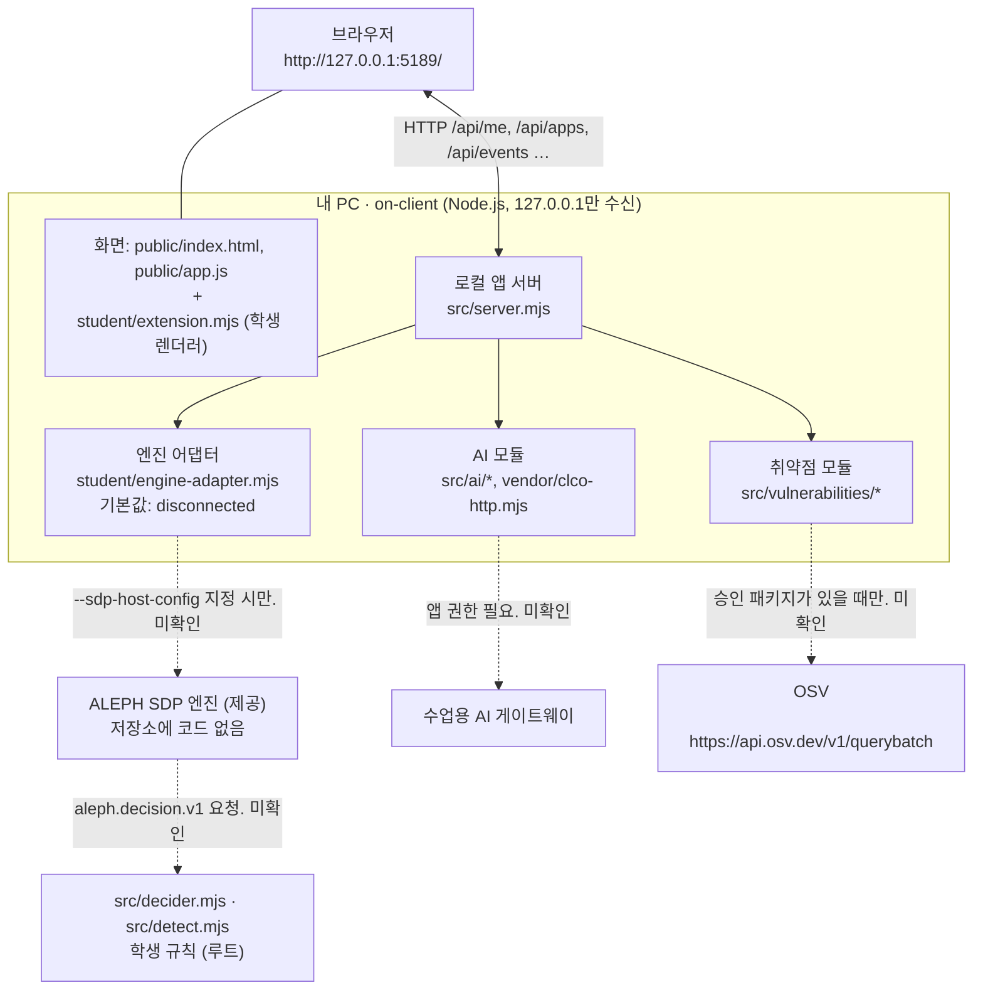

# 보안 Agent 「케셰브」 학생 실행 설명서 및 시스템 구성도

21단계 문서입니다. 다른 사람이 이 저장소를 받아 `on-client` 앱을 로컬에서 실행하고, 정상 시작 신호를 확인하고, 문제가 났을 때 확인 순서를 따라갈 수 있게 합니다.

**근거 표기 규칙** — 이 문서의 각 항목은 아래 셋 중 하나로 구분합니다.

| 표기 | 뜻 |
|---|---|
| **실행 확인** | 2026-10-25에 이 PC에서 명령을 실제로 실행해 결과를 본 것 |
| **코드 확인** | 코드·설정 파일을 읽어 확인했지만 실행하지는 않은 것 |
| **미확인** | 실행하지도 않았고 코드만으로 단정할 수 없는 것. 성공이라고 읽지 마세요 |

---

## 1. 목적과 기능

- **목적**: 회사 직원 본인의 기기·세션 상태, 업무 앱 접속 판정, 접속 기록과 보안 경보, AI 설명과 조치 상태, 설치 패키지의 공개 취약점 대조를 한 화면에서 보여 주는 로컬 보안 앱입니다.
- **화면 (탭 이름은 `on-client/public/index.html` 기준, 코드 확인)**: 「보호 현황」 · 「업무 앱」 · 「보안 기록」
- **이 저장소는 두 부분으로 되어 있습니다.**
  1. **저장소 루트** (1~12단계): Vercel에 배포하는 가상 자료실, 판정기(`src/decider.mjs`)와 탐지기(`src/detect.mjs`).
  2. **`on-client/`** (13~20단계): 이 문서가 설명하는 로컬 보안 앱. 루트와 별도의 `package.json`을 갖고 있습니다.

---

## 2. 필요 프로그램과 확인한 버전

| 항목 | 값 | 근거 |
|---|---|---|
| 운영체제 | Windows 11 Home 10.0.26200 | 실행 환경 정보 |
| PowerShell | Windows PowerShell 5.1 기준. 7+ 는 미확인 | 미확인 |
| Node.js | `v24.19.0` | 실행 확인 (`node --version`) |
| npm | `11.17.0` | 실행 확인 (`npm --version`) |
| 앱 패키지 | `alekov-client-starter@0.2.11` | 코드 확인 (`on-client/package.json`) |
| Node 허용 범위 | `on-client/package.json`의 `engines.node`는 정확히 `24.19.0`. 런처 `tools/start-alekov.ps1`은 22~24만 허용하고 24.19.0이 아니면 "참고" 문구만 출력 | 코드 확인 |
| 외부 패키지 설치 | `on-client/package.json`에 `dependencies`가 없으므로 `on-client`에서 `npm install`은 필요 없음 | 코드 확인 |
| Git | 저장소를 받을 때만 필요. 버전 미확인 | 미확인 |

---

## 3. 폴더 구조와 작업 위치

작업 위치는 **저장소 최상위 폴더** `choi-bujang-secret-vault/`이고, 앱 실행은 그 안의 `on-client/`에서 합니다.

```text
choi-bujang-secret-vault/
├── README.md                    # 프로젝트 설명 (21단계 절 포함)
├── AGENTS.md                    # 코딩 도구 공통 규칙
├── aleph.config.json            # 배포 주소·로그인 발급자·허용 경로 (공개 가능 값만)
├── package.json                 # 루트(1~12단계) 스크립트. 아래 "루트 명령" 참고
├── vercel.json, schema.sql      # 배포·DB 양식
├── api/                         # 루트: Vercel 서버 함수 (notes, notices, device, ops, checks, restore …)
├── public/                      # 루트: 배포 화면(설치형 웹앱)
├── src/
│   ├── decider.mjs              # 학생 작성: 접속 판정 규칙
│   ├── detect.mjs               # 학생 작성: 탐지 규칙(회수 '제안'만)
│   └── attack-check.mjs …       # 학생 자기 점검 등
├── scripts/, test/, policy/, xdr/, package/   # 루트: 연습 도구·시험·정책 사본·연습 경보·양식
├── docs/
│   ├── STUDENT_RUNBOOK.md       # 이 문서
│   ├── DECIDER_REQUEST.md       # 판정 요청·응답 계약 (제공)
│   ├── DETECT_EVENTS.md         # 탐지 사건 형식 (제공)
│   └── EVIDENCE.md              # 실측 표
└── on-client/                   # ★ 13~20단계 로컬 보안 앱 (케셰브)
    ├── package.json             # start / demo / check 스크립트
    ├── src/server.mjs           # 로컬 앱 서버 (제공)
    ├── src/engine.mjs           # 엔진 어댑터 로더 + 예제 엔진 (제공)
    ├── src/ai/, src/vulnerabilities/, src/actions/, src/connection/, src/engine/   # 제공 모듈
    ├── vendor/clco-http.mjs     # 수업용 AI 게이트웨이 HTTP 호출 (제공)
    ├── public/                  # index.html, app.js, vulnerabilities-view.mjs, style.css (제공)
    ├── student/extension.mjs    # ★ 학생 작성: 화면 렌더러
    ├── student/engine-adapter.mjs   # 제공 틀: 기본값은 연결 안 됨(disconnected)
    ├── tools/start-alekov.ps1   # 시작 도구 (제공)
    └── docs/                    # 제공 안내 문서
```

코드 확인: 위 파일은 폴더 조회와 `git ls-files`로 존재를 확인했습니다. `on-client/package-lock.json`은 **없습니다.**

---

## 4. 실행 절차 (처음 보는 사람을 위한 3대 실행 안내)

이 저장소는 사용자의 실행 위치나 선호하는 방식에 따라 **3가지 방법 중 하나를 골라 즉시 실행**할 수 있습니다.

### [방법 1] 저장소 루트에서 바로 실행 (가장 추천하는 방법)
저장소 최상위 폴더(`choi-bujang-secret-vault`)에서 PowerShell을 열고 바로 입력합니다:

```powershell
# 예제 관제 대시보드 모드로 실행 (실측 PC 자원 + 가상 이벤트)
npm run demo

# 또는 기본 연결 점검 모드로 실행
npm start
```
- **정상 시작 신호**: 콘솔에 `케셰브 예제: http://127.0.0.1:5189` 가 출력됩니다. — **실행 확인**
- 루트 `package.json`과 `on-client`가 연결되어 있어 `cd on-client` 없이도 `Missing script` 오류 없이 즉시 구동됩니다.

### [방법 2] Inno Setup 설치 프로그램(setup.exe)으로 실행 (설치형 패키지)
Node.js 콘솔 조작 없이 일반 윈도우 프로그램처럼 실행하는 방법입니다:
1. `dist-installer\setup.exe` 파일을 더블 클릭하여 실행합니다. (관리자 권한 UAC 불필요, 사용자 로컬 설치)
2. 설치가 끝나면 바탕화면의 **「케셰브 (보안 Agent)」** 바로가기를 누르거나, 아래 설치 경로의 스크립트를 실행합니다:
   ```cmd
   %LOCALAPPDATA%\Programs\Keshev\start-keshev.cmd
   ```
- **정상 시작 신호**: 브라우저에 관제 대시보드가 자동으로 열리며 `http://127.0.0.1:5189`에 연결됩니다. — **실행 확인**

### [방법 3] on-client 하위 폴더에서 직접 실행
```powershell
cd on-client
npm run check  # 문법 검사 (node --check student/extension.mjs)
npm run demo   # 데모 모드 실행
```

---

### 4-4. 브라우저 접속 및 화면 확인
서버가 켜지면 웹 브라우저에서 아래 주소를 엽니다:
```text
http://127.0.0.1:5189/
```
- **정상 결과 (화면 구성)**:
  1. 상단 관제 대시보드 4대 카드 (기기 무결성, 업무 앱 접속 판정, 보안 경보, 패키지 취약점)
  2. 하단 실시간 추이 막대 (자원 안전 마진 및 보호 지수)
  3. 학생 상태 영역 최상단:
     - 1. 내 PC 하드웨어(CPU/메모리/디스크) 실측 및 초경량 안전 마진 분석 `[실측 값]`
     - 2. 네트워크 어댑터 구성 및 Windows 방화벽(읽기 전용)·운영 이벤트 진단 `[실측 값 · 읽기 전용]` (비침해 고지 및 `[SDP 미연결]` 분리)
     - 3. 원클릭 통합 진단 보고서 복사

---

### 4-5. 문제 발생 시 한 줄 복구법 (장애 해결)
1. **`EADDRINUSE: :::5189` (포트가 이미 사용 중이라는 오류 발생 시)**:
   - 이전 실행 창이 백그라운드에 남아 있는 경우입니다. PowerShell에서 아래 한 줄을 실행하면 즉시 정리됩니다:
     ```powershell
     Get-Process node | Stop-Process -Force
     ```
   - 또는 다른 포트로 실행하려면:
     ```powershell
     $env:ON_PORT=5190; npm run demo
     ```
2. **조회 실패 시 화면 안내**:
   - 서버가 꺼져 있거나 일시적 오류 발생 시 가짜 숫자로 위장하지 않고, 화면에 **❌ [실패한 항목]**, **사유**, **▶ 다음에 할 일** 안내 박스가 표시됩니다.
   - 서버를 재기동한 후 해당 카드의 **「다시 조회」** 버튼을 누르면 정상 복구됩니다.

---

### 루트 명령 (1~12단계, `on-client`가 아니라 저장소 최상위에서 실행)
| 명령 | 용도 | 비고 |
|---|---|---|
| `npm install` | 루트 의존성(`@supabase/supabase-js`, `jose`) 설치 | 루트에 `node_modules/` 없음(코드 확인). 설치는 이번에 하지 않음 |
| `npm run decider:test` · `detect:test` · `fixture:7` | 가상 요청 연습 | **심판 판정이 아닙니다.** 이번 점검에서는 실행하지 않음 |
| `node --test test/package-starter.test.mjs` | 시작 틀 점검 | 3건 통과 — 실행 확인 |

---

## 5. 시스템 구성도

### 5-1. Mermaid



- 실선은 이 저장소 코드 안에서 호출 경로를 확인한 연결, 점선은 **설정이 있을 때만 쓰이거나 이번에 실제 연결을 확인하지 못한 연결**입니다.
- 로컬 앱 서버가 `src/decider.mjs`를 직접 호출하는 코드는 없습니다(`on-client/src`·`student`에서 `decider` 검색, 코드 확인). 판정기는 ALEPH SDP 엔진이 `docs/DECIDER_REQUEST.md` 계약으로 부르는 쪽이며, 그 연결은 이 저장소에 엔진이 없어 **미확인**입니다.

### 5-2. 같은 내용을 표로

| 구성 요소 | 위치·주소 | 하는 일 | 제공/학생 | 근거 |
|---|---|---|---|---|
| 브라우저 | `http://127.0.0.1:5189/` | 탭 화면 표시, 사용자 조작 | — | 응답 200 실행 확인 |
| 화면 | `on-client/public/index.html`, `app.js` | 상태 관리, 학생 렌더러 호출 | 제공 | 코드 확인 |
| 학생 렌더러 | `on-client/student/extension.mjs` | `createStudentView()`가 돌려주는 객체의 `render*` 8개 | **학생** | 코드 확인 |
| 로컬 앱 서버 | `on-client/src/server.mjs` | 정적 파일, `/api/me·apps·events·devices·sessions·access·diagnostics·vulnerabilities·ai/*·actions/*` | 제공 | 코드 확인. `diagnostics`·`vulnerabilities` 응답은 실행 확인 |
| 엔진 어댑터 | `on-client/student/engine-adapter.mjs` | SDP 호스트 기능을 받아 서버에 전달. 기본값 `evidenceMode: 'disconnected'` | 제공 틀 | 코드 확인 |
| ALEPH SDP 엔진 | 저장소 밖 | 신원·기기 확인, 판정 요청 전달, 조치 집행 | 제공 | 미확인 |
| 판정기·탐지기 | `src/decider.mjs`, `src/detect.mjs` | 판정 규칙, 회수 제안 | **학생** | 엔진 연동 미확인 |
| 수업용 AI 게이트웨이 | `on-client/vendor/clco-http.mjs`로 호출 | 연결 점검, 사건 설명 | 제공 | 미확인 (진단에서 `ai.configured:false`, `authorized:false`) |
| OSV | `https://api.osv.dev/v1/querybatch` | 승인된 공개 패키지의 취약점 대조 | 제공 | 주소는 코드 확인, 요청은 보내지 않음 |

---

## 6. 구현·경계·확인 상태 표

### 6-1. 학생이 구현한 함수 (`on-client/student/extension.mjs`)

`extension.mjs`가 내보내는 것은 `createStudentView()` 하나이고, 아래 8개는 그 객체의 메서드입니다. 이름은 공식 계약대로입니다.

| 단계 | 메서드 | 맡은 화면 | 이번 확인 |
|---|---|---|---|
| 13 | `renderIdentity` | 신원·기기·세션 | 코드 확인(존재) |
| 14 | `renderDecision` | 접속 판정 4상태와 요청 실패 | 코드 확인(존재) |
| 15 | `renderEvents` | 접속 기록·경보 목록 | 코드 확인(존재) |
| 16 | `renderStatus` | 안내·진단 | 코드 확인(존재) |
| 17 | `renderAiConnection` | AI 연결 상태 | 코드 확인(존재) |
| 18 | `renderExplanation` | 근거 바인딩 AI 설명 | 코드 확인(존재) |
| 19 | `renderAction` | 조치 상태 | 코드 확인(존재) |
| 20 | `renderVulnerabilities` | 패키지 취약점 | 코드 확인(존재) |

문법 점검 `npm run check`는 통과(실행 확인). **8개 메서드의 분기별 동작은 이번 점검에서 실행하지 않았고, 실제 브라우저 화면도 보지 않았습니다 — 미확인.** 이전 작업 기록의 모의 DOM 점검은 이번에 재현하지 않았으므로 확인 완료로 세지 않습니다.

### 6-2. 제공 코드 경계 (수정하지 않음)
`on-client/src/**`, `on-client/public/**`, `on-client/vendor/**`, `on-client/tools/**`, 인증·판정 서버 설정.

### 6-3. 확인 상태 요약

| 항목 | 상태 |
|---|---|
| Node/npm 버전 | 실행 확인 |
| `npm run check` | 실행 확인(통과) |
| `npm run demo` 시작 신호, `GET /` 200, `/api/diagnostics` | 실행 확인 (포트 5199) |
| `npm start` 시작 신호, `ENGINE_NOT_CONNECTED`, `PROJECT_NOT_CONFIGURED` | 실행 확인 (포트 5198) |
| 같은 포트 재사용 시 `EADDRINUSE` | 실행 확인 (포트 5199) |
| `node --test test/package-starter.test.mjs` | 실행 확인(3건 통과) |
| `start-alekov.ps1` 실행, `Ctrl + C` 종료 | 미확인 |
| 브라우저에서 탭·버튼·문구 | 미확인 |
| SDP 엔진 연결, 판정 연동 | 미확인 |
| AI 게이트웨이 연결·권한 | 미확인 |
| OSV 실제 조회 | 미확인 |
| 조치 준비·집행·결과 | 미확인 |
| 배포(Vercel) 상태, 심판 판정 | 미확인 |

---

## 7. 오류별 확인 순서

화면 문구는 `on-client/student/extension.mjs`·`public/*.mjs`에 있는 것만 적었습니다(코드 확인). 문구가 실제 화면에 뜨는 것은 미확인입니다.

| 증상 | 가능한 원인 | 확인 순서 |
|---|---|---|
| `Error: listen EADDRINUSE … 127.0.0.1:<포트>` | 같은 포트를 다른 프로세스가 사용 중 — **실행 확인** | ① `Get-NetTCPConnection -LocalPort 5189 -State Listen`으로 프로세스 확인 ② 내가 띄운 `node`면 종료 ③ 또는 `$env:ON_PORT=5190; npm start`로 다른 포트 사용 |
| `INVALID_PORT` | `ON_PORT`가 1024~65535 정수가 아님 (코드 확인) | `ON_PORT` 값 확인 |
| 런처가 Node 버전 문구를 출력하고 멈춤 | Node 가 22~24 범위 밖 (코드 확인) | `node --version` 확인 후 24.19.0 설치 |
| 신원·기록이 비어 있거나 확인 불가 | `ENGINE_NOT_CONNECTED`: 엔진 어댑터 미연결이 기본값 — **실행 확인** | ① `http://127.0.0.1:5189/api/diagnostics`의 `engine.mode` 확인 ② 예제 연습은 `npm run demo` ③ 실제 연결은 운영 측 안내(`--sdp-host-config`)가 필요. 학생이 임의로 만들지 않음 |
| `AI_REQUEST_UNVERIFIED` | AI 앱 권한 미확인 (진단의 `ai.authorized:false` — 실행 확인) | 운영 담당자에게 앱 권한 확인. 열쇠 값은 문서·채팅에 붙여 넣지 않음 |
| 패키지 `조회 준비 미완료` (`not_configured`, `PROJECT_NOT_CONFIGURED`) | `ON_PROJECT_DIRECTORY`(절대 경로)가 없음 — **실행 확인** | 운영 안내에 따라 설정. 없으면 취약점 없음이 아니라 **조회 안 한 것** |
| 패키지 `아직 조회 안 함` (`not_checked`, `NO_APPROVED_PACKAGES`) | `ON_APPROVED_PUBLIC_PACKAGES`에 승인 패키지가 없음 (코드 확인) | 승인 목록은 운영 측 값. 비어 있으면 조회하지 않는 것이 정상 |
| 패키지 `lock 파일 확인 불가` (`unverifiable`) | `ON_PROJECT_DIRECTORY` 아래 `package-lock.json`을 읽지 못함 (코드 확인) | 그 폴더의 `package-lock.json` 존재와 JSON 형식 확인. (`on-client/`에는 lock 파일이 없음) |
| `패키지 조회를 취소했습니다.` | 사용자가 「패키지 조회 취소」를 누름 | 정상. 「설치 패키지 조회」를 다시 누름 |
| `패키지 조회 응답이 늦어 중단했습니다.` | 응답 시간 초과 | 잠시 뒤 「설치 패키지 조회」를 직접 다시 누름. 자동 재시도 없음 |
| `패키지 조회를 지금 처리할 수 없습니다.` | OSV 호출 불가 | 네트워크 확인 후 직접 재시도 |
| 조치 `결과 불명` | 서버가 접수했어도 실제 효과 관측이 없음 | 성공으로 보지 않음. 「원천 결과만 재조회」 버튼으로 다시 조회 |
| `확인 기한 지남` | 사람 확인 기한 초과 | 만료된 확인으로는 집행하지 않음. 조치를 처음부터 다시 준비 |

---

## 8. 지원하지 않는 환경과 미확인 항목

- Windows 11 + Node 24.19.0 외의 환경(macOS, Linux, Node 22·23, PowerShell 7)은 확인하지 않았습니다.
- 이 문서의 명령 중 6-3 표에서 "실행 확인"으로 적은 것만 실제로 실행했습니다. 나머지는 코드를 읽은 것이거나 미확인입니다.
- 서버가 이 문서의 명령을 실행해 확인하지는 않습니다. 설명이 코드와 맞는지는 제출된 커밋의 파일을 읽어 대조합니다.
- 외부 인증 자격 증명(인증서, 접속 암호, API 인증 키)은 문서·코드·Git에 넣지 않습니다. 필요한 값은 .env.example을 참고하여 제출에서 제외되는 로컬 파일이나 공식 비밀 입력란에만 둡니다.
