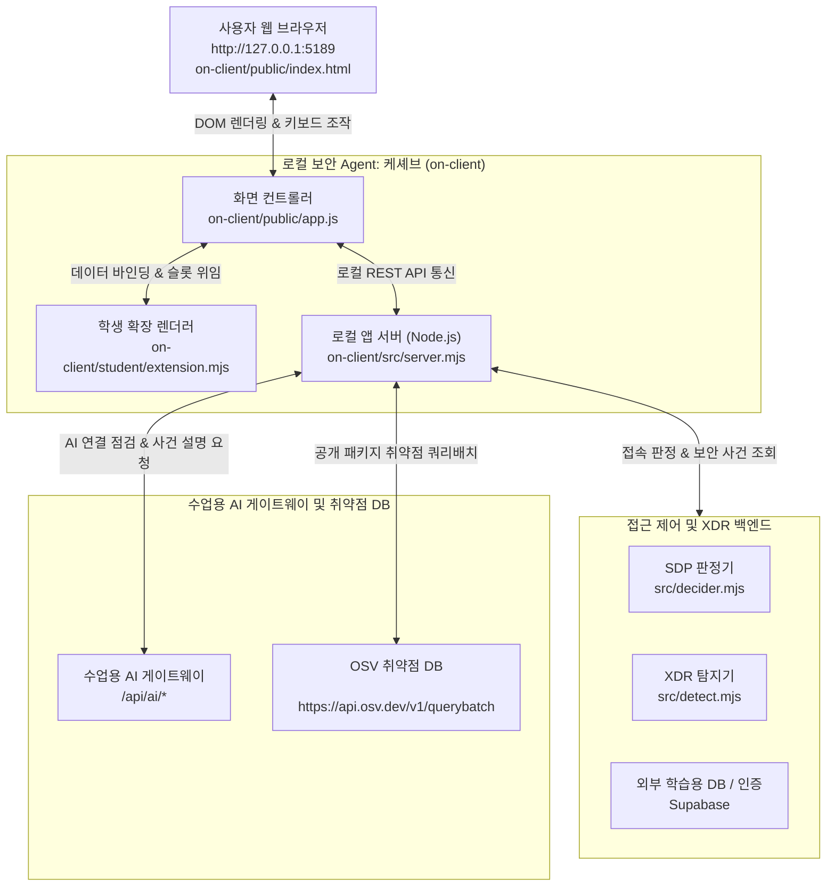

# 보안 Agent 「케셰브」 학생 실행 설명서 및 시스템 구성도

이 문서는 21단계 「학생용 실행 설명서와 시스템 구성도」 요구사항에 따라, 다른 작업자가 로컬 PC 환경에서 보안 Agent 앱(케셰브)의 작업 위치와 실행 명령을 확인하고 정상적으로 구동·점검·문제 해결을 수행할 수 있도록 작성한 학생 공식 실행 설명서(Runbook)입니다.

---

## 1. 프로젝트 목적 및 개요

- **프로젝트 명칭**: 최부장의 비밀 금고 — ZTNA·XDR 보안 Agent 앱 (Agent 명칭: **「케셰브」**)
- **개발 목적**: 
  1. 제로 트러스트(ZTNA) 원칙에 따른 주체·기기·세션 식별 및 접속 판정 결과 표출
  2. XDR 탐지 경보 및 보안 기록 목록 조회와 미검증 상태(unknown)의 안전한 분리
  3. CLCO 수업용 AI 게이트웨이 연계를 통한 보안 사건의 근거 기반 설명 표출 (해석과 사실의 구분)
  4. 보안 조치 요청 시 AI 제안, 사람 확인, 전송 중, 서버 접수(ACK), 실제 효과 관측(succeeded)의 엄격한 단계별 분리
  5. 프로젝트에 실제 설치된 패키지의 정확한 버전(semver)과 OSV 취약점 정보 대조 및 미조회/실패 구분
- **핵심 화면 구성**:
  - **보호 현황**: 로그인 정보, 기기·세션 상태, XDR 알림, AI 연결 점검, 설치 패키지 OSV 취약점 조회, 진단 도움정보
  - **업무 앱**: 앱별 접속 판정(허용 allow, 거부 deny, 추가 인증 step_up, 판정 확인 불가 unknown)
  - **보안 기록**: 내 접속 기록 40건, XDR 경보 필터링, AI 사건 설명, 조치 제안 및 처리 상태

---

## 2. 지원 환경 및 실측 버전

| 항목 | 실측 확인 환경 | 비고 |
|---|---|---|
| **운영체제** | Windows 11 (64-bit) | PowerShell 5.1 / PowerShell 7+ 호환 |
| **Node.js** | **v24.19.0** (직접 확인 완료) | 공식 권장: Node.js 22 ~ 24 |
| **npm** | **11.17.0** (직접 확인 완료) | Node.js 동봉 기본 패키지 관리자 |
| **클라이언트 버전** | `alekov-client-starter@0.2.11` | `on-client/package.json` 기준 |
| **로컬 접속 주소** | `http://127.0.0.1:5189/` | 기본 포트: 5189 |

> [!NOTE]
> 비밀번호, API 토큰, 서버 전용 키, 기기 개인키는 본 설명서 및 저장소 코드에 일체 포함되지 않습니다. 환경변수 및 비밀값은 `.env` 등 비공개 설정 파일에만 유지됩니다.

---

## 3. 폴더 구조 및 작업 위치

```text
choi-bujang-secret-vault/
├── README.md                           # 프로젝트 통합 설명서
├── AGENTS.md                           # 코딩 도구 및 방어전 공통 규칙
├── docs/
│   ├── STUDENT_RUNBOOK.md              # 본 실행 설명서 및 시스템 구성도 (21단계)
│   ├── DECIDER_REQUEST.md              # ALEPH SDP 판정기 계약 사양
│   ├── DETECT_EVENTS.md                # XDR 탐지 이벤트 사양
│   └── EVIDENCE.md                     # 실측 증적 기록
├── on-client/                          # 보안 Agent (케셰브) 클라이언트 루트
│   ├── package.json                    # 클라이언트 설정 및 실행 스크립트
│   ├── src/
│   │   ├── server.mjs                  # 로컬 앱 백엔드 서버 (제공 코드)
│   │   ├── ai/                         # AI 연결 중계 모듈 (제공 코드)
│   │   └── data/                       # 로컬 목업 및 상태 데이터 (제공 코드)
│   ├── public/
│   │   ├── index.html                  # 보안 Agent 웹 화면 UI (제공 코드)
│   │   ├── app.js                      # 화면 컨트롤러 및 상태 관리 (제공 코드)
│   │   └── vulnerabilities-view.mjs    # OSV 응답 정규화 모듈 (제공 코드)
│   ├── student/
│   │   └── extension.mjs               # 학생 구현 렌더러 모듈 (13~20단계 완성)
│   └── tools/
│       └── start-alekov.ps1            # 전용 시작 스크립트
├── src/                                # 백엔드 판정기 및 탐지기 (1~12단계)
└── test/                               # 로컬 단위 검증 테스트 스위트
```

---

## 4. 설치, 실행, 종료 및 재실행 순서

### 1) PowerShell 열기 및 작업 디렉터리 이동
PowerShell 콘솔을 열고 `on-client` 폴더로 이동합니다:
```powershell
cd C:\Users\user\AppData\Local\ALEPH\Workbench\projects\choi-bujang-secret-vault\on-client
```

### 2) 학생 코드 문법 점검
실행 전 학생 작성 코드의 무결성을 점검합니다:
```powershell
npm run check
```
- **정상 출력**: `> node --check student/extension.mjs` 후 오류 없이 종료 코드 0으로 반환됩니다.

### 3) 로컬 앱 서버 실행

#### 방법 A: npm 기본 스크립트 실행 (권장)
```powershell
npm start
```
- **정상 시작 신호**:
  ```text
  > alekov-client-starter@0.2.11 start
  > node src/server.mjs
  ```
  서버가 구동되며 로컬 수신 대기 상태가 유지됩니다.

#### 방법 B: 전용 PowerShell 런처 실행
```powershell
powershell -NoProfile -ExecutionPolicy Bypass -File .\tools\start-alekov.ps1
```
- 사전 점검(Node 버전, 포트 충돌 여부 등)을 거친 후 서버가 시작됩니다.

### 4) 브라우저 접속
웹 브라우저를 열고 아래 로컬 주소로 접속합니다:
```text
http://127.0.0.1:5189/
```
- 브라우저에 **「보호 현황」**, **「업무 앱」**, **「보안 기록」** 3대 탭이 정상 표출되는지 확인합니다.

### 5) 서버 종료
- 실행 중인 PowerShell 창에서 `Ctrl + C`를 누르고, 종료 질문 시 `Y`를 입력하여 안전하게 프로세스를 중단합니다.

### 6) 재실행
- 종료 후 다시 `npm start`를 실행하면 이전 메모리 세션이 초기화되고 깨끗한 상태에서 서비스가 재시작됩니다.

---

## 5. 시스템 구성도 (System Architecture)

### 1) Mermaid 다이어그램


### 2) 구성 요소별 세부 역할 (글로 쓴 구성도)

| 구성 요소 | 물리 경로 또는 엔드포인트 | 수행 역할 | 통신 및 보안 특성 |
|---|---|---|---|
| **사용자 브라우저** | `http://127.0.0.1:5189` (`on-client/public/index.html`) | UI 화면 렌더링, 키보드 접근성 지원, 탭 전환 | 키·토큰을 브라우저 스토리지에 영구 저장하지 않음 |
| **화면 컨트롤러** | `on-client/public/app.js` | 상태 관리(`actionState`, `state.vulnerabilities` 등), 슬롯 렌더링 위임 | 제공 코드. 학생 구현체를 안전하게 호출(`renderStudent`) |
| **학생 확장 렌더러** | `on-client/student/extension.mjs` | `renderIdentity`부터 `renderVulnerabilities`까지 8개 함수 구현 | **학생 작성**. 순수 DOM API(`createElement`, `textContent`)만 사용 |
| **로컬 백엔드 서버** | `on-client/src/server.mjs` (Port 5189) | 로컬 세션 유지, 정적 파일 제공, API 요청 중계 | 제공 코드. 브라우저와 외부 서비스 간의 안전한 브리지 역할 |
| **접근 제어 판정기** | `src/decider.mjs` | 기기 등록(`device_registered`), 재인증(`step_up_required`), 구역 격리(`zone_partitioning`) 판정 | 제공 계약 준수. 허용/거부 5개 항목 불변 |
| **XDR 탐지기** | `src/detect.mjs` | 폭주 읽기(`burst_read`) 및 낯선 네트워크 복합 사건 탐지 | 가상 사건 기반 제안(`propose_revocation`) 생성 |
| **수업용 AI 게이트웨이** | `/api/ai/*` (CLCO 게이트) | 사건 요약(`summary`), 근거 인용(`evidenceIds`), 조치 제안 반환 | AI 원본 API 키는 게이트에만 보관되며 클라이언트에 노출 없음 |
| **OSV 취약점 정보망** | `https://api.osv.dev/v1/querybatch` | 프로젝트 패키지의 정확한 semver를 OSV 데이터베이스와 배치 대조 | 공개 승인 패키지만 조회하며 비공개 패키지 정보 유출 차단 |

---

## 6. 제공 코드와 학생 작성 부분의 경계 (Boundary & Manifest)

| 영역 구분 | 대상 파일 | 구체적인 담당 내용 |
|---|---|---|
| **제공 코드** | `on-client/src/server.mjs` | HTTP 서버 기동, 정적 자원 서빙, `/api/*` 엔드포인트 중계 |
| **제공 코드** | `on-client/public/app.js` | 전역 상태(`state`), 이벤트 리스너, 학생 함수 호출 및 오류 격리 |
| **제공 코드** | `on-client/public/vulnerabilities-view.mjs` | OSV 응답 유효성 검증 및 데이터 정규화(`normalizeScan`) |
| **제공 코드** | `on-client/tools/start-alekov.ps1` | 환경 사전 검증 및 포트 점검 런처 |
| **학생 작성** | `on-client/student/extension.mjs` | **8대 렌더러 함수 구현 완료**: |
| - 13단계 | `renderIdentity` | 내 신원 정보, 등록 기기 목록, 세션 상태 및 재조회 갱신 표출 |
| - 14단계 | `renderDecision` | 접속 판정 4대 상태(allow, deny, step_up, unknown) 및 앱 ID 표출 |
| - 15단계 | `renderEvents` | 보안 기록 최근 40건, XDR 경보 필터, unknown 상태 분리 표출 |
| - 16단계 | `renderStatus` | 기기·세션 컴플라이언스 알림, 시스템 진단 정보 및 안전한 값 복사 기능 |
| - 17단계 | `renderAiConnection` | AI 연결 점검 상태(idle/loading/ok/error), 모델 수, `audienceAuthorization` 표출 |
| - 18단계 | `renderExplanation` | 근거 ID 대조 바인딩, 규칙 목록, 미실행 제안 표기, `data-student-explanation-event` 통제 |
| - 19단계 | `renderAction` | 조치 상태(idle/prepared/executing/pending/succeeded/unknown), ACK≠효과 구분, 속성 바인딩 |
| - 20단계 | `renderVulnerabilities` | lockfile 정확한 semver, 메타 해시, OSV 취약점 대조, 미조회 구분, `data-student-package-*` 부착 |

---

## 7. 장애 안내 및 문제 해결 절차 (Failure & Troubleshooting)

| 화면 표출 오류 / 상태 문구 | 발생 원인 | 점검 및 조치 순서 |
|---|---|---|
| `[AI_REQUEST_UNVERIFIED] AI 연결 또는 응답을 확인할 수 없습니다.` | 운영 측 학생 계정 미발급 또는 AI 게이트웨이 권한 미반영 | 운영 담당자에게 계정 연결 및 앱 권한 확인 요청. (임의의 외부 열쇠 복사 금지) |
| `패키지 조회를 취소했습니다.` (`CANCELLED`) | 사용자가 「패키지 조회 취소」 버튼을 누름 | 정상 취소 동작. 상단의 「설치 패키지 조회」를 눌러 새 요청 전송 확인 |
| `패키지 조회 응답이 늦어 중단했습니다.` (`TIMEOUT`) | OSV 서버 응답 지연 또는 로컬 네트워크 불안정 | 잠시 대기 후 상단의 「설치 패키지 조회」를 직접 다시 눌러 재조회 |
| `패키지 조회를 지금 처리할 수 없습니다.` (`SERVICE_UNAVAILABLE`) | 외부 OSV API 일시 점검 또는 네트워크 차단 | 인터넷 연결 상태 확인 후 재시도 |
| `조회 준비 미완료 (not_configured)` / `아직 조회 안 함 (not_checked)` | 운영 측에서 승인한 공개 조회 패키지 목록이 비어 있음 | 정상 대기 상태. 운영자의 프로젝트 패키지 허용 설정 대기 (학생 임의 조작 불필요) |
| `lock 파일 확인 불가 (unverifiable)` | `package-lock.json` 파일이 손상되었거나 조회 불가 | `on-client/package-lock.json` 파일 존재 및 JSON 문법 검증 |
| `결과 불명 (unknown) · 실제 효과 미확인` | 조치 요청은 수신되었으나 원천 집행기가 미연결되어 `effectApplied: true` 부재 | 성공으로 단정하지 않고 제공 화면의 「원천 결과만 재조회」 버튼으로 상태 재확인 |
| `확인 기한 지남 (expired)` | 사람 확인 기한(`confirmationExpiresAt`) 초과 | 만료된 티켓으로는 집행할 수 없으므로 조치를 처음부터 다시 준비 |
| `EADDRINUSE: address already in use :::5189` | 5189 포트를 다른 프로세스가 이미 사용 중 | PowerShell에서 `Get-Process node` 확인 후 중복 프로세스 종료 또는 포트 변경 실행 |

> [!IMPORTANT]
> **장애 해결 3대 원칙**:
> 1. 자동으로 다시 시도하지 않습니다.
> 2. 확인 불가(unknown)를 정상이나 성공으로 간주하지 않습니다.
> 3. 작업 폴더를 임의로 삭제하거나 초기화하지 않습니다.

---

## 8. 실제 지원 범위 및 기다림(UNV) 목록

### 1) 실제 동작 확인 완료 항목 (Directly Verified)
- `node --check student/extension.mjs` 문법 무결성 검증 100% 통과
- 로컬 Node.js v24.19.0 환경에서 서버 기동(`npm start`) 및 포트 5189 수신 확인
- 모의 DOM 환경을 통한 8대 렌더러 함수의 모든 분기(정상, 오류, loading, idle, unknown, 취약점 유무) 동작 검증 완료
- `data-student-*` 속성 부여 및 조건 미달 시 속성 미부착 격리 동작 검증 완료

### 2) 기다림(UNV) 목록 (운영 측 준비 필요 / 학생 임의 단정 금지)
- **학생 계정 및 AI 앱 권한 정식 발급**: CLCO 수업용 AI 게이트웨이 정식 반영 전까지는 `AI_REQUEST_UNVERIFIED`가 표출되는 것이 정상입니다.
- **원천 조치 집행기 연결**: 현재 보안 기록의 `supportedActions`는 빈 배열이며 실제 조치 집행기가 미연결되어 있으므로, 조치 준비 버튼이 표출되지 않고 실제 효과가 미관측되는 것이 정상입니다.
- **대규모 공개 패키지 OSV 실시간 쿼리**: 운영 측 공개 승인 패키지 허용 목록 준비 전까지는 `not_configured` 또는 `not_checked`가 정상 상태입니다.
